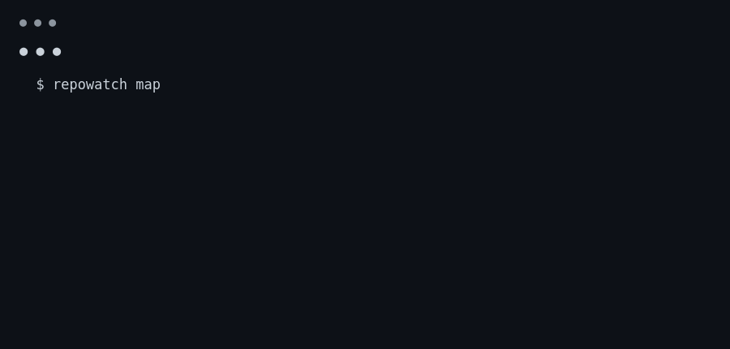

# repowatch

[](https://github.com/QexleOSS/repowatch/actions/workflows/ci.yml)
[](LICENSE)




repowatch builds a ranked structural index of a repository. It reads imports and calls, scores every file, and writes one text index you can open and diff. One native binary built with the OCaml standard library reads the tree, writes `.repowatch/index`, and runs offline.

## Why repowatch

- **Rank.** PageRank over import and call edges finds the files the repository leans on. A 200-line database module outranks a 9,000-line router that wraps three functions.
- **A read set with a receipt.** `set "task"` returns the smallest set of files, then reports how much of the dependency graph that set covers, which edges leave, and what it excluded.
- **Cycles and size.** `check` fails CI on an import cycle or a file above 2,000 lines.
- **Drift.** `snapshot` and `drift` show files that appeared, files that vanished, and rank moves.
- **One binary.** It uses the OCaml standard library and Unix, builds with `ocamlopt`, and runs from a copy.
- **73 languages.** 62 of them get symbols and imports, across 138 extensions.
- **Editor ready.** LSP, tags, JSON, a self-contained graph, and an Obsidian wiki.

## Quick start

```sh
curl -fsSL https://raw.githubusercontent.com/QexleOSS/repowatch/main/install.sh | sh
cd your-project
repowatch map
```

Linux and macOS binaries come from the release page. On Windows, run the Linux binary under WSL or build from source.

From source:

```sh
./build.sh        # needs ocamlopt 5.x
./tests/run.sh    # 44 end-to-end checks
```

## Map

```
$ repowatch map
repowatch  /home/you/app
7 files · 8 symbols · 22 lines · 12 edges

├─ src
│  ├─ db.ts  ##### 0.324    2 sym      3 ln
│  ├─ session.ts  ##### 0.300    2 sym      4 ln
│  ├─ router.ts  ##    0.099    1 sym      3 ln
│  ├─ legacy.ts  ##    0.069    1 sym      2 ln
│  ├─ report.ts  ##    0.069    1 sym      3 ln
│  └─ server.ts  ##    0.069    1 sym      4 ln
└─ tests
   └─ session.test.ts  ##    0.069    0 sym      3 ln
```

PageRank runs 40 iterations over import edges (weight 0.4) and call edges (weight 0.6). Directories sort by their best file. `--budget N` stops the tree at N lines and prints what it left out.

## Read set

```
$ repowatch set "session expiry"
read set for "session expiry"

  src/session.ts                     seed
  tests/session.test.ts              seed
  src/db.ts                          from src/session.ts
  src/router.ts                      uses src/session.ts
  src/report.ts                      uses src/session.ts
  src/server.ts                      uses src/session.ts

6 files · 20 lines
covers 100% of the edge closure · 12 inside · 0 leaving
excluded 1 files (2 lines)
```

`set` matches task words against paths and symbol names, takes the four best files as seeds, walks imports forward four hops, and pulls in the files that import a seed. Seeds stay inside the budget.

The receipt carries two numbers. `covers` is the share of edges with both ends inside the set. `leaving` counts edges that cross the boundary.

## Check and drift

```
$ repowatch check
checked 7 files · 12 edges

ok: no cycles, no oversized files
```

```
$ repowatch snapshot release-1
saved release-1 · 204 files · 28,140 lines

$ repowatch drift release-1
since release-1

  files   204 -> 211
  lines   28,140 -> 29,302 (+1,162)

added (7)
  + src/billing/plan.ts
rank moves
  src/billing/plan.ts  140 -> 12
```

`check` exits 1 on findings, so CI fails when a new cycle lands.

## Commands

| command         | result                                           |
| --------------- | ------------------------------------------------ |
| `map`           | ranked tree, with a line budget                  |
| `set TASK`      | smallest read set, with a receipt                |
| `refs NAME`     | definitions and callers                          |
| `why PATH`      | role, score, importers, symbols                  |
| `check`         | cycles and oversized files, exits 1 on findings  |
| `snapshot NAME` | record the current shape                         |
| `drift [NAME]`  | compare against a snapshot                       |
| `stats`         | totals per language and support tier             |
| `tags`          | tags file for Vim, Neovim, and other tag readers |
| `graph`         | self-contained HTML node-link graph              |
| `wiki`          | markdown pages that open as an Obsidian vault    |
| `watch`         | rebuild when files change                        |
| `lsp`           | language server on stdio                         |

Flags: `--root DIR`, `--budget N`, `--json`, `--out PATH`.

`--json` works on each command. Each command prints one object.

## Measured

Corpus: 2,001 TypeScript files, 66,002 lines, 60,001 symbols, 5.7 MB. Five runs each, median wall time, one machine.

| tool        | command                | median | output                             |
| ----------- | ---------------------- | ------ | ---------------------------------- |
| tag scanner | one full tree scan     | 0.84 s | 60,001 tags                        |
| repowatch   | `repowatch map` (cold) | 0.71 s | 60,001 symbols, 5,911 edges, ranks |
| repowatch   | `repowatch map` (warm) | 0.15 s | same                               |

Django 5.0, 634,337 lines across 3,584 indexed files:

| tool        | command                | median | output                       |
| ----------- | ---------------------- | ------ | ---------------------------- |
| tag scanner | one full tree scan     | 0.94 s | 66,471 tags                  |
| repowatch   | `repowatch map` (cold) | 1.37 s | 39,289 symbols, 14,457 edges |
| repowatch   | `repowatch map` (warm) | 0.27 s | same                         |

A tag scanner reports more tags because it tags assignments and vendored JavaScript. repowatch counts symbols and builds the graph. A warm run reuses the index. A tag file is rebuilt every run.

## Languages

73 languages, 138 extensions. Each language gets one of four tiers, and `stats` prints the tier for each.

| tier                    | languages                                                                                                                                                                                                                                                                                               |
| ----------------------- | ------------------------------------------------------------------------------------------------------------------------------------------------------------------------------------------------------------------------------------------------------------------------------------------------------- |
| symbols, imports, calls | TypeScript, TSX, JavaScript, Python, Rust, Go, C, C++, Java, C#, OCaml, Zig, Kotlin, Scala, Swift, Dart, Julia, Objective-C, Solidity, Protobuf, Vue, Svelte, R                                                                                                                                         |
| symbols, imports        | Ruby, PHP, Haskell, Lua, Ada, SQL, Elixir, Erlang, Clojure, Nix, Perl, F#, Groovy, PowerShell, Fortran, Pascal, GraphQL, Terraform, Nim, Crystal, D, shell, Verilog, VHDL, Starlark, CMake, Visual Basic, Assembly, Prolog, Lisp, MSBuild, solutions, Razor, XAML, Elm, Vala, COBOL, ABAP, Apex, MATLAB |
| links                   | Markdown, PDF, images                                                                                                                                                                                                                                                                                   |
| files                   | YAML, JSON, TOML, Dockerfile, Makefile, GLSL, HLSL, OpenCL                                                                                                                                                                                                                                              |

CUDA maps to the C++ tier. C# and F# sit in the graph, and `.csproj`, `.sln`, `.props`, and `.targets` files add the project references that connect a .NET solution. Solid 2.0 signals, stores, and memos appear as symbols in `.tsx` and `.js`. A `.h` file with `namespace` or `template<` resolves as C++. A `.m` file with `#import` resolves as Objective-C, and one with `function` resolves as MATLAB. Adding a language takes a registry entry in `src/lang.ml` and a rule in `src/lex.ml`.

## Editors

`repowatch lsp` speaks the Language Server Protocol on stdio and answers definition, references, and workspace symbols. It builds the index on the first request.

```lua
-- Neovim
vim.lsp.start({ name = "repowatch", cmd = { "repowatch", "lsp" } })
```

```toml
# Helix, languages.toml
[language-server.repowatch]
command = "repowatch"
args = ["lsp"]
```

VS Code: open `editors/vscode` in VS Code and press F5, or package it with `vsce package` and install the `.vsix`. The extension starts `repowatch lsp` on startup; set `repowatch.path` if the binary is not on `PATH`.

Emacs: `(add-to-list 'eglot-server-programs '(fundamental-mode . ("repowatch" "lsp")))`.

`repowatch tags --out tags` writes a tags file for Vim, Neovim, and anything else that reads the format. No external tag program is required, on any platform.

## Visual outputs

```
repowatch graph --out graph.html    # open in a browser, click a node to dim the rest
repowatch wiki --out docs/wiki      # open the folder in Obsidian
repowatch watch                     # rebuild on change, print the new top files
```

## Star history

[](https://star-history.com/#QexleOSS/repowatch&Date)
